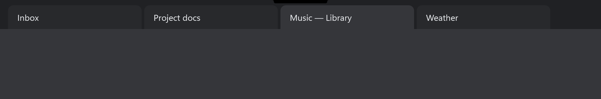

# Dynamic Island for Windows

A macOS / iPhone-style **island at the top of your screen** for Windows 11 — it shows what's playing and your incoming notifications, then gets out of the way.

<p align="center">
  
</p>

> 🇹🇷 Türkçe açıklama aşağıda — [Türkçe](#türkçe)

## Features

| | |
|---|---|
|  | **Now playing** — cover, title and an equalizer that reacts to the real audio (bass → treble). Works with Spotify, browsers (YouTube…), and anything that shows up in Windows' media controls. |
|  | **Hover to expand** — previous / play-pause / next and a live progress bar. |
|  | **Notifications** — other apps' notifications drop down from the island for a few seconds. Click one to open the app. Several in a row are queued. |
|  | **Stays out of your tabs** — when a window sits under the island, it tucks into a thin line after 4 s, so browser tabs remain clickable. Hover the line to open it. Over a free desktop it stays visible. |

- **Invisible when idle** and **never shows over fullscreen apps** (games, F11 video, presentations) — even when focus is on another monitor.
- Never steals focus, doesn't appear in Alt+Tab, clicks pass through everywhere outside the island.
- Spring animations, per-monitor DPI aware, near-zero CPU when idle.
- Tray icon (Turkish UI): start with Windows, notification sound, setup guide, quit.

## Requirements

- Windows 11 (or Windows 10 2004+)
- [.NET 11 SDK](https://dotnet.microsoft.com/download) to build

## Install

```powershell
git clone https://github.com/vezironi/windows-dynamic-island.git
cd windows-dynamic-island
powershell -ExecutionPolicy Bypass -File packaging\build.ps1
& "$env:LOCALAPPDATA\DynamicIsland\app\DynamicIsland.exe"
```

`build.ps1` publishes the app to `%LOCALAPPDATA%\DynamicIsland\app`. On first launch a setup window asks for **notification access**.

### Silencing Windows' own notification banners

Windows has no API to suppress another app's toast pop-ups, so to avoid seeing every notification twice:

- turn on **Do Not Disturb** (notifications still reach the notification center, the island reads them from there and plays its own sound), **or**
- in *Settings → System → Notifications*, turn off **"Show notification banners"** for the apps you want on the island.

## How it works

| Piece | Windows API |
|---|---|
| Now playing + controls | `GlobalSystemMediaTransportControlsSessionManager` (GSMTC) |
| Notifications | `UserNotificationListener` (polled every second — the change event isn't available to unpackaged apps) |
| Equalizer | WASAPI loopback via [NAudio](https://github.com/naudio/NAudio) + FFT into 4 bands — only while the compact island is visible |
| Fullscreen / "is something under the island?" | `SHQueryUserNotificationState`, foreground window, z-ordered `EnumWindows` |
| Window | WPF, layered + `WS_EX_NOACTIVATE` / `WS_EX_TOOLWINDOW`, `WS_EX_TRANSPARENT` toggled by cursor position |

All decisions (when to show, expand, tuck, queue, hide) live in a pure, unit-tested state machine in `src/DynamicIsland.Core`.

```
src/DynamicIsland.Core/        pure logic: state machine, springs, notch geometry, fullscreen rules, FFT bands
src/DynamicIsland/             WPF app: island window, views, Windows adapters, tray
tests/DynamicIsland.Core.Tests xUnit tests
packaging/                     build / install script (optional sparse-package identity)
docs/                          design spec, implementation plan, README images
```

```powershell
dotnet test tests/DynamicIsland.Core.Tests
```

README images are rendered from the real views with made-up data:

```powershell
DynamicIsland.exe --screenshots docs\images
```

## Notes

- The equalizer listens to everything your speakers play (not the microphone), so a voice call moves the bars too.
- Notification clicks open the sending app; they can't jump to the exact chat (Windows doesn't expose a toast's launch arguments to other apps).
- If a future Windows build blocks notification access for unpackaged apps, `build.ps1 -WithIdentity` registers a signed sparse package (run `packaging\create-cert.ps1` as admin once).

Not affiliated with Apple. "Dynamic Island" describes the UI style.

---

## Türkçe

Windows 11 için ekranın üst ortasında duran, **macOS / iPhone tarzı bir ada**.

- **Müzik:** çalan şarkının kapağı, adı ve gerçek sese tepki veren ses dalgası. Üzerine gelince ⏮ ⏯ ⏭ butonları ve ilerleme çubuğu açılır. Spotify, YouTube (tarayıcı) ve Windows medya kontrollerine düşen her şeyle çalışır.
- **Bildirimler:** diğer uygulamaların bildirimleri adada birkaç saniye görünür. Tıklayınca uygulama açılır.
- **Sekmeleri kapatmaz:** adanın altında bir pencere varsa 4 saniye sonra ince bir çizgiye çekilir, sekmeler tıklanabilir kalır. Çizginin üzerine gelince açılır. Masaüstü boşsa ada görünür kalır.
- **Boştayken görünmez**, tam ekran oyun / video açıkken **hiç çıkmaz** (odak diğer monitörde olsa bile).
- Odak çalmaz, Alt+Tab'da görünmez, adanın dışındaki tıklamalar arkadaki pencereye geçer.

**Kurulum:** yukarıdaki *Install* adımları. İlk açılışta bildirim erişimi istenir. Windows'un kendi bildirim kutucuklarını susturmak için **Rahatsız Etme** modunu açın ya da *Ayarlar → Sistem → Bildirimler*'den ilgili uygulamalar için **"Bildirim başlıklarını göster"** seçeneğini kapatın.

## License

[MIT](LICENSE). Media icons from [Font Awesome Free](https://fontawesome.com) (CC BY 4.0) — see [THIRD-PARTY-NOTICES.md](THIRD-PARTY-NOTICES.md).
